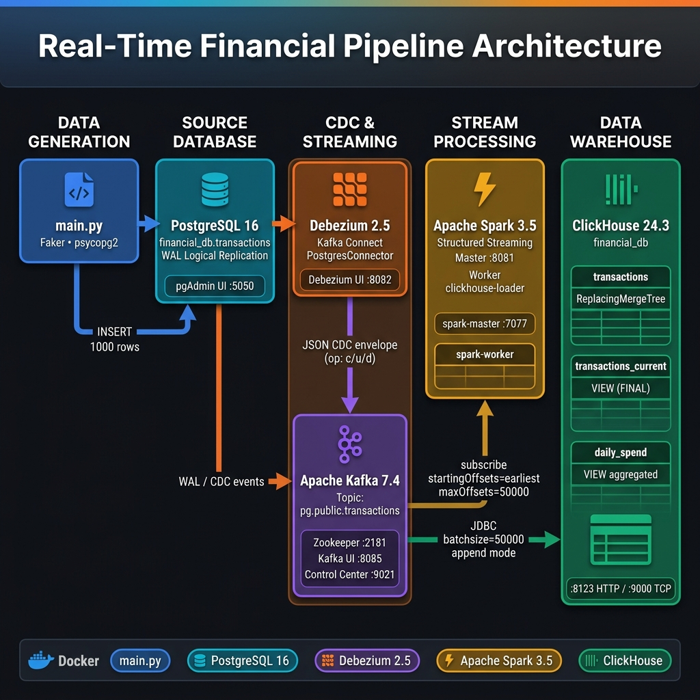

# Real-Time Financial Transactions Pipeline

A production-style, end-to-end **streaming data platform** that ingests financial transactions, streams changes via CDC, processes them with Apache Spark, and lands them in ClickHouse for analytics.

## Architecture



## Stack

| Component | Technology | Purpose |
|---|---|---|
| Source DB | PostgreSQL 16 (WAL logical) | Transactional store |
| CDC | Debezium 2.5 + Kafka Connect | Capture insert/update/delete events |
| Message Bus | Apache Kafka 7.4 (Confluent) | Event streaming backbone |
| Stream Processor | Apache Spark 3.5 Structured Streaming | Parse CDC envelopes, type-cast, write |
| Warehouse | ClickHouse 24.3 (ReplacingMergeTree) | Analytical queries & dashboards |
| Orchestration | Docker Compose with health-checks | One-command local stack |

## Project Structure

```
.
├── main.py                        # Seed script: generates & inserts fake transactions into PostgreSQL
├── transactions_stream.py         # Spark structured streaming job (Kafka → ClickHouse)
├── docker-compose.yml             # Full stack definition (Postgres, Kafka, Debezium, Spark, ClickHouse)
├── .env.example                   # Environment variable template
├── jobs/
│   ├── spark_to_clickhouse.py     # Spark job entry-point (symlink / copy of transactions_stream.py)
│   └── spark_to_snowflake.py      # Alternative Snowflake sink (reference)
└── sql/
    ├── clickhouse_init.sql/
    │   └── clickhouse__init.sql   # ClickHouse schema: transactions table + views
    └── postgres_init.sql          # PostgreSQL schema: transactions table + indexes
```

## Quick Start

### Prerequisites
- Docker & Docker Compose v2
- Python 3.10+ (for the seed script only)

### 1. Configure environment
```bash
cp .env.example .env
# Edit .env and set your CLICKHOUSE_PASSWORD (and optionally KAFKA_TOPIC)
```

### 2. Start the full stack
```bash
docker compose up -d
```
This starts: PostgreSQL → Zookeeper → Kafka → Debezium → Spark (master + worker) → ClickHouse.

Wait ~60 s for all health checks to pass:
```bash
docker compose ps   # all should show (healthy)
```

### 3. Register the Debezium CDC connector
```bash
curl -s -X POST http://localhost:8093/connectors \
  -H "Content-Type: application/json" \
  -d @debezium/pg-connector.json
```
> See `debezium/pg-connector.json` for a ready-made connector payload.

### 4. Seed PostgreSQL with transactions
```bash
python -m venv venv && source venv/bin/activate
pip install psycopg2-binary faker
python main.py          # inserts 1 000 rows by default
# NUM_RECORDS=5000 python main.py   # to insert more
```

### 5. Run the Spark → ClickHouse pipeline
```bash
docker compose --profile jobs up clickhouse-loader
```
The job uses `trigger(availableNow=True)`: it processes every unread Kafka offset since the last checkpoint and exits cleanly.

### 6. Query ClickHouse
```bash
# Interactive client
docker exec -it clickhouse clickhouse-client \
  --user clickhouse --password <your_password>

-- Row count
SELECT count() FROM financial_db.transactions_current;

-- Daily spend by country
SELECT * FROM financial_db.daily_spend ORDER BY day DESC LIMIT 20;
```

Or open the built-in ClickHouse Play UI at **http://localhost:8123/play**.

## Service URLs

| Service | URL | Credentials |
|---|---|---|
| ClickHouse HTTP / Play UI | http://localhost:8123/play | clickhouse / *your password* |
| Spark Master UI | http://localhost:8081 | — |
| Kafka UI | http://localhost:8085 | — |
| Debezium UI | http://localhost:8082 | — |
| Confluent Control Center | http://localhost:9021 | — |
| pgAdmin | http://localhost:5050 | admin@admin.com / admin |

## ClickHouse Schema

### `financial_db.transactions` (landing table)
`ReplacingMergeTree(version, is_deleted)` — one row per CDC event. `version` = Debezium `ts_ms`; `is_deleted = 1` for deletes.

### `financial_db.transactions_current` (view)
Applies `FINAL` de-duplication and filters out soft-deleted rows. **Use this for analytics.**

### `financial_db.daily_spend` (view)
Pre-aggregated daily spend grouped by `country`, `currency`, and `payment_method`.

## Re-running the Loader

The Spark job uses checkpoints (`jobs/_checkpoints/`). Re-running it will only process **new** Kafka messages since the last run. To replay from scratch:
```bash
rm -rf jobs/_checkpoints/transactions_clickhouse
docker compose --profile jobs up clickhouse-loader
```

## License
MIT
